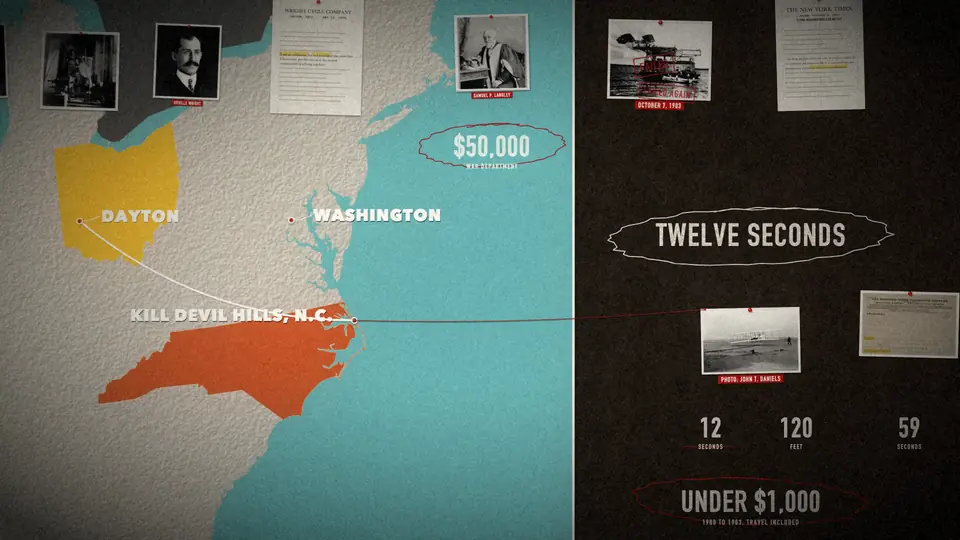
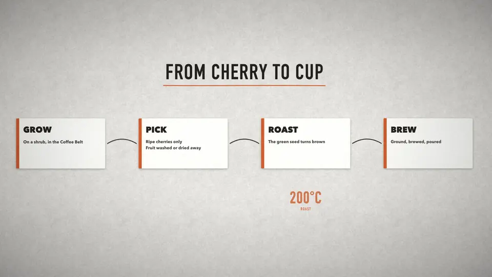

<h1 align="center">Cinematic Skill</h1>

<p align="center">Narrated cinematic films, built entirely from code, by your coding agent.</p>

<p align="center">
  <a href="LICENSE"></a>
  &nbsp;
  
  &nbsp;
  <a href="https://github.com/Moh4696/cinematic-skill/actions/workflows/check.yml"></a>
</p>

<p align="center">
  
</p>

Ask your agent for "a 90 second documentary about the Wright brothers" and it writes the script, records a voice, finds public-domain photos with their licences, and builds one continuous camera move over a single designed world. Stamps slam, highlighters swipe and numbers roll up on the exact word the narrator says. It finishes with sound effects, an optional score and burned-in captions.

Nothing is generated video. Every frame is drawn by code (Skia, in Python), so the film renders the same every time, changes are cheap, and a new voice re-times the whole film by itself.

<table>
  <tr>
    <td width="50%"></td>
    <td width="50%"></td>
  </tr>
</table>

<sub>Left: the final frame of "Twelve Seconds", the 90 second documentary that ships as the worked example, made from seven public-domain photos. Right: the starter explainer that every new project begins as.</sub>

## Install

```bash
npx skills add Moh4696/cinematic-skill
```

That uses the [`npx skills`](https://github.com/vercel-labs/skills) CLI (Node 22.20+). It installs for Claude Code, Codex, Cursor, Gemini CLI, OpenCode and dozens more. Start a new agent session afterwards.

<details>
<summary>Claude Code plugin</summary>

```
/plugin marketplace add Moh4696/cinematic-skill
/plugin install cinematic-skill@cinematic-skill
```

</details>

<details>
<summary>Codex plugin</summary>

```bash
codex plugin marketplace add Moh4696/cinematic-skill
codex plugin add cinematic-skill@cinematic-skill
```

</details>

<details>
<summary>Gemini CLI</summary>

```bash
gemini extensions install https://github.com/Moh4696/cinematic-skill
```

</details>

<details>
<summary>Without Node: the shell installer</summary>

```bash
curl -fsSL https://raw.githubusercontent.com/Moh4696/cinematic-skill/main/install.sh | bash
```

It clones to `~/.cinematic-skill` and links the skill into every coding agent it finds. Run it again to update. From a clone: `./install.sh --claude --codex`, `./install.sh --dir path/to/skills`, `./install.sh --copy`, `./install.sh --uninstall`.

</details>

Then install what the scripts use:

```bash
pip install -r requirements.txt      # skia-python, numpy, pillow (scipy optional)
```

ffmpeg must be on your PATH. The skill's `check_setup.py` checks everything and says what's missing.

## What it makes

| Kind | Look | Images |
| --- | --- | --- |
| Documentary, history, true crime | Cork evidence wall, slate | Archive photos and documents, black and white |
| Product launch, brand or founder story | Studio, charcoal | Your own product shots and photos, in colour |
| Science, engineering, how it works | Blueprint, paper | Diagrams, archive or AI stills |
| Tech, space, trailers | Night | Screenshots, renders, AI stills |

The items work on every look:

- photos and torn newspaper clippings
- typeset documents with real quotes
- clean cards
- big distressed type and rolling counters
- stamps, pen circles and highlighter swipes
- red string between prints
- maps of any country, with filled regions, routes and markers

A spotlight follows the camera so each line has one hero.

## How it works

1. **Story.** The agent researches, fact-checks and writes the script: one idea per line, and time only moves forward after the opening. Each line also says what the camera shows. A beat table with a chronology lint goes to you for approval.
2. **Voice.** A free scratch voice (macOS `say` or espeak-ng) times the film first. The final voice can be any TTS or a person, recorded one section at a time and split into timed lines automatically. Suspect cuts get flagged.
3. **Images.** Wikimedia Commons search and download, with each licence recorded. Non-free files are refused. You can also add your own photos or AI stills. `credits.md` is written for you.
4. **Scene.** A short Python file places items on the voice's timing (`doc.W(line, "word")`) and keys the camera.
5. **Review.** The agent renders stills and contact strips of every move and checks them for known mistakes before showing you a draft.
6. **Sound and finish.** It synthesises the sound effects (nothing to license) and mixes them with the voice and an optional score, ducked and loudness-normalised. A memory-aware parallel render follows, then four caption styles and an SRT.

The agent stops for your approval after the beat table, the look, and a 30 second draft.

## Try the example

```bash
cd skills/cinematic-film/scripts
python3 new_project.py ~/wright --example
python3 fetch_commons.py get --project ~/wright
python3 make_map.py --project ~/wright && python3 prep_assets.py --project ~/wright
python3 tts_say.py --project ~/wright && python3 split_takes.py --project ~/wright && python3 build_narration.py --project ~/wright
python3 render.py --project ~/wright --size 1280x720 --out out/draft.mp4 --audio audio/narration.m4a
```

On a 16 GB laptop the 92 second film renders at 1080p in about 6 minutes.

## Credits

Built from a 5 minute documentary about Al Capone that exploraX made with an agent, then opened up to any subject. The single-camera evidence-wall method follows [Zane Hoyer's tutorial on code-built documentaries](https://www.youtube.com/watch?v=e2Fykz51Nxg). The rules and code here are our own, written from what broke along the way. The example film uses public-domain photographs from Wikimedia Commons; see its `photos.json`.

## Works well with

- [Open 3D Skills](https://github.com/Moh4696/open-3d-skills): three.js scenes, scroll films and frame-exact recording, from the same author. Its `motion-assets` skill plans AI stills.

## Feedback

Open an issue or a pull request, or find me on X at [@exploraX_](https://x.com/exploraX_).

## License

[MIT License](LICENSE) · Copyright (c) 2026 exploraX
